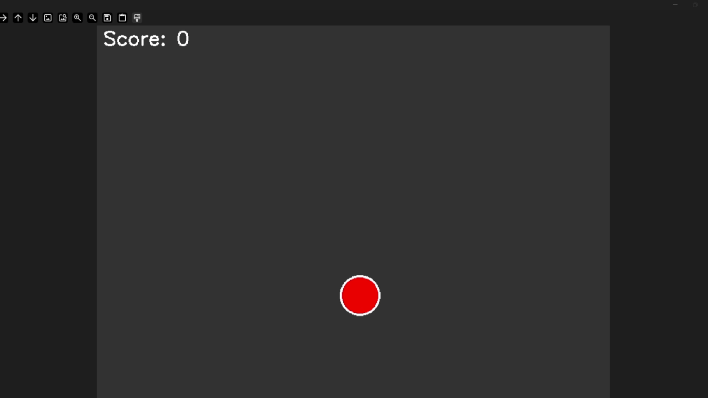

# PIDaim

> [!WARNING]
> the program need run in the main monitor, or it may have problem  

it is a fork of [this](https://github.com/FuDi121314/PIDaim)
change env to use cuda
use PID to aim

## environment
download vcpkg
```
git clone https://github.com/Microsoft/vcpkg.git
cd vcpkg
.\bootstrap-vcpkg.bat     # start up
# optional:
.\vcpkg install opencv[cuda]:x64-windows  # this will install the needed lib for cuda
# once dont have cuda
```

## compile and run  
```
mkdir build
cd build
# change the path to yout own vcpkg
cmake .. -G "Visual Studio 17 2022" -A x64 -DCMAKE_TOOLCHAIN_FILE=C:to/your/path/vcpkg/scripts/buildsystems/vcpkg.cmake
cmake --build . --config Release
```
recommend **p: 22.5 i: 15 d: 0.0005** for the base game test.
after complie the file, 2 files named "Base" and "AutoAim" will be  created
Run "Base" first and then the "AutoAim"

## demo

following is a demo of the program (the cursor may be laggy to see)
or you can goto "/sample/demo.mp4" to see.
<p align="center">
    <picture>
      <source srcset="sample/demo.gif" />
      
  </picture>
</p>


## customize 
1) try adjust the PID 